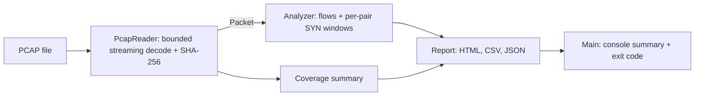

# TraceLens

[](https://github.com/Mariaax6/tracelens/actions/workflows/ci.yml)
[](LICENSE)

**An offline network-traffic analyser in Java 17.** It reads classic PCAP files, aggregates directional flows and flags time-bounded TCP SYN port-diversity patterns, with explicit coverage counters so you always know what was and wasn't analysed. Designed as an undergraduate networks and defensive-security project.

No external libraries, capture driver, administrator privileges, network connection or live capture are needed. The bundled PCAP files are synthetic lab data using documentation address ranges (RFC 5737).

[Español](README.es.md) · [Example report](https://mariaax6.github.io/tracelens/demo/report.html) · [Changelog](CHANGELOG.md)

## Quick start

Download `tracelens.jar` from the [releases page](https://github.com/Mariaax6/tracelens/releases) (a `.sha256` file is published next to it), or build it with a JDK 17+:

```sh
sh build.sh                      # Linux/macOS: compile, test, package
```
```powershell
.\build.ps1 -JdkHome 'C:\Program Files\Java\jdk-21'   # Windows
```

Then analyse the synthetic demo capture:

```sh
java -jar dist/tracelens.jar examples/demo.pcap reports/demo
```

```text
TraceLens 2.0.0 | input=demo.pcap | Ethernet
RECORDS=33 DECODED=33 FLOWS=19 ALERTS=1
ALERT   192.0.2.20 -> 198.51.100.10 at 2023-11-14T22:13:25.200Z: 12 distinct SYN ports (1000, 1001, ..., 1011)
Report: /path/to/reports/demo/report.html
```

Open `reports/demo/report.html`; `flows.csv` holds every flow for a spreadsheet and `summary.json` is for automation. `sh demo.sh` (or `.\demo.ps1`) runs every example and asserts the exit codes and counts.

| Example | What it shows | Records | Decoded | Flows | Alerts |
|---|---|---:|---:|---:|---:|
| `demo.pcap` | UDP, ICMP, a 16-port SYN burst and repeated SYNs to one port | 33 | 33 | 19 | 1 |
| `slow-diverse.pcap` | Negative control: 20 ports, 11 s apart, nanosecond big-endian file | 20 | 20 | 20 | 0 |
| `coverage.pcap` | Linux SLL capture with snaplen truncation, IPv6, ARP, a fragment, GRE, a malformed header and an out-of-order timestamp | 9 | 4 | 3 | 0 |

In `demo.pcap` the alert fires on the twelfth distinct SYN destination port; later attempts fall within the per-pair cooldown. These are deliberately incomplete synthetic conversations, not recordings of a real attack.

## CLI

```text
java -jar tracelens.jar <capture.pcap> <report-dir> [options]

  --threshold <ports>   Distinct SYN destination ports that raise an alert (2-65536, default 12)
  --window <seconds>    Sliding window length (default 10, maximum 86400)
  --html-rows <n>       Flows shown in report.html (default 500; flows.csv always has all)
  --fail-on-alert       Exit with code 1 when any alert is raised
  --version             Print the version and exit
  -h, --help            Show help
```

Exit codes: **0** analysis completed (alerts included, unless `--fail-on-alert`) · **1** alerts with `--fail-on-alert` · **2** invalid input, unsupported format or usage error. Reports are written only after the whole capture has been read successfully, so a failed run leaves no partial output. Reusing a report directory overwrites its generated files.

To analyse your own traffic, capture on a network you own or are authorised to monitor, for example `sudo tcpdump -i eth0 -w capture.pcap` (or `-i any`, which produces Linux SLL). Captures from Wireshark default to PCAPNG; convert them with `editcap -F pcap in.pcapng out.pcap`.

## What is implemented

- Streaming reader for classic PCAP 2.4: both byte orders, microsecond and nanosecond timestamps (kept as exact integer nanoseconds), SHA-256 of the input.
- Link types: Ethernet (with up to two 802.1Q/802.1ad VLAN tags), Linux cooked capture (SLL, from `tcpdump -i any`) and raw IPv4.
- IPv4 with TCP, UDP and ICMP headers. Records cut by the snapshot length are still decoded when their headers are complete.
- Directional five-tuple flows with packet counts, original wire lengths, first/last timestamps and the union of TCP flags seen.
- Sliding-window detection of distinct SYN (without ACK) destination ports per source **and** destination pair. Retransmissions to one port do not add diversity; each pair can alert again only after one window. Alerts list the window start and a sample of ports.
- Coverage counters for every record that was not analysed (non-IPv4, other protocols, malformed, fragments), plus snaplen truncation and out-of-order timestamps. Every record is classified exactly once; the tests check this.
- HTML report (light/dark, bounded preview of the busiest flows), full CSV export and a JSON summary with alerts.

## Design



| Class | Responsibility |
|---|---|
| `PcapReader` | Global and record headers, link layer, IPv4/TCP/UDP/ICMP decoding, coverage counters |
| `Packet` | One decoded header; protocol and flag names |
| `Analyzer` | Flow table and detection windows, with bounded state |
| `Report` | HTML, CSV and JSON rendering with escaping |
| `Main` | CLI parsing, console output, exit codes |

Each source/destination pair keeps only the latest SYN time per destination port, ordered oldest first, so memory per pair is bounded by the 65,536 possible ports and expiry is amortised constant time. Window diversity is the size of that map. Detection uses a monotonic clock, so a slightly out-of-order timestamp never moves the window backwards.

State is bounded: at most 100,000 flows (packets of later new flows are counted as untracked), 200,000 active detection pairs (stale pairs are swept; SYNs that still don't fit are counted as unevaluated), 50 million records and a 16 MiB snapshot length. When a limit is reached the analysis continues and the report says what was left out. This is an educational tool for small and medium captures, not a line-rate IDS.

## Tests

`build.sh` / `build.ps1` run the framework-free `Tests` entry point (119 checks): both byte orders and timestamp precisions, exact nanoseconds, every link type, VLAN stacking, snaplen truncation, malformed and lying length fields, fragments, out-of-order timestamps, retransmissions, SYN-ACK exclusion, window expiry and its inclusive boundary, cooldown, per-pair grouping, all state limits, HTML/CSV/JSON output (with a strict JSON validity check) and every CLI exit code. The tests also regenerate the example captures and require them to be **byte-identical** to the committed files. `demo.sh` then verifies the packaged JAR end to end. CI runs both on Java 17 and 21.

Regenerate the fixtures after building:

```sh
java -cp build/classes:build/tests io.github.mariaax6.tracelens.Fixtures examples
```

To cross-check the decoding with an independent tool, for example: `tshark -r examples/demo.pcap -T fields -e ip.src -e ip.dst -e tcp.dstport -e tcp.flags`.

## Limits and interpretation

- Not supported: PCAPNG, IPv6, fragment reassembly, TCP stream reassembly, other link types. Unsupported traffic is counted, never silently turned into flows.
- No payload inspection, application identification, decryption or checksum validation during analysis.
- An alert is a heuristic lead. Legitimate service discovery can trigger it; slow, distributed or UDP scans and attempts spread across targets can evade it. Zero alerts does not mean a safe network.
- No precision/recall, real-world detection, throughput or production-readiness claims have been measured.
- Wire bytes are original frame lengths, not payload bytes. The UDP demo traffic uses empty datagrams to port 53; DNS is not parsed.

## Suggested next experiments

1. Build a labelled benign/scan corpus and measure precision and recall across thresholds and windows.
2. Add IPv6 with extension-header tests, or PCAPNG in a separate reader.
3. Add canonical bidirectional flows and compare them with Wireshark's Conversations view.

## Opening in an IDE

Open this directory in IntelliJ IDEA or import `pom.xml` in NetBeans with JDK 17+. The POM is optional IDE metadata and may download Maven plugins; the scripts above are the offline build and verification path. `mvn test` does not run the custom test entry point, so use `build.sh` / `build.ps1`.

## Development provenance

The code, fixtures, documentation and the 2.0.0 revision were produced with AI assistance. No individual contribution history, course grade, real-world deployment or measured security impact is claimed. Before presenting this as your portfolio work, study the code, reproduce the results and document the changes and experiments you carry out yourself. See also [SECURITY.md](SECURITY.md).

## References

- [PCAP capture file format (draft-ietf-opsawg-pcap)](https://datatracker.ietf.org/doc/draft-ietf-opsawg-pcap/) · [tcpdump link-layer header types](https://www.tcpdump.org/linktypes.html) · [Linux cooked capture (SLL)](https://www.tcpdump.org/linktypes/LINKTYPE_LINUX_SLL.html)
- [IPv4, RFC 791](https://www.rfc-editor.org/rfc/rfc791) · [TCP, RFC 9293](https://www.rfc-editor.org/rfc/rfc9293) · [UDP, RFC 768](https://www.rfc-editor.org/rfc/rfc768) · [Documentation addresses, RFC 5737](https://www.rfc-editor.org/rfc/rfc5737)
