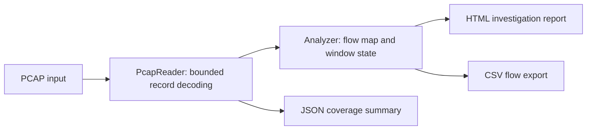

# TraceLens

**An offline network-traffic analyser in Java 17.** Reads classic PCAP files, aggregates directional flows and flags time-bounded TCP SYN port-diversity patterns. Designed as an undergraduate networks and defensive-security project.

No external Java libraries, packet-capture driver, administrator privileges, network connection or live capture are required. Included PCAP files are synthetic lab data using documentation address ranges.

## Run the included demonstration

Requires a **JDK 17 or later** to build, or Java 17+ to run the prebuilt JAR. On this computer JDK 21 was available at `C:\Program Files\Java\jdk-21`.

Windows PowerShell, from this project directory:

```powershell
.\build.ps1 -JdkHome 'C:\Program Files\Java\jdk-21'
& 'C:\Program Files\Java\jdk-21\bin\java.exe' -jar dist/tracelens.jar examples/demo.pcap reports/demo
```

Linux/macOS with a JDK on PATH:

```sh
sh build.sh
java -jar dist/tracelens.jar examples/demo.pcap reports/demo
```

Open `reports/demo/report.html` in a browser. The generated CSV is suitable for a spreadsheet and the JSON summary is suitable for automation.

Expected demonstration: **33 records, 33 decoded, 19 directional flows, one alert**. The alert fires on the twelfth distinct SYN destination port in the window. Subsequent traffic stays within a per-pair ten-second cooldown. These SYN requests are deliberately incomplete synthetic conversations, not recordings of an actual attack.

A negative control demonstrates window expiry:

```sh
java -jar dist/tracelens.jar examples/slow-diverse.pcap reports/slow-diverse
```

Expected: **20 records, 20 flows, zero alerts**, because attempts are eleven seconds apart.

## CLI

```text
java -jar dist/tracelens.jar <capture.pcap> <report-directory> [distinct-ports=12] [window-seconds=10]
```

Minimum threshold: 2. Window: any positive finite number. Input must have nondecreasing timestamps. Exit code 0 means analysis completed, even with alerts; 2 means invalid input, unsupported format or a resource limit. Outputs are written after the entire input has been successfully analysed. Reusing a report directory overwrites its generated reports.

## What is implemented

- Streaming parser for PCAP 2.4: both byte orders and microsecond/nanosecond timestamps.
- Ethernet, up to two 802.1Q/802.1ad VLAN tags, IPv4 and TCP/UDP/ICMP headers.
- Directional five-tuple flow aggregation, packet counts, captured frame wire lengths and first/last timestamps.
- Sliding-window distinct destination-port detection, grouped by source **and** target, for SYN without ACK. Retransmitting one port does not increase diversity.
- Human-readable investigation findings; bounded HTML preview; full CSV flow export; JSON coverage summary.
- Explicit counters for unsupported protocols, malformed/incomplete packets, fragments and capture truncation.
- Deterministic fixture generator and framework-free regression tests.

## Design



`PcapReader` validates lengths before reading transport headers. IP fragments are skipped rather than misinterpreted as complete packets. Unsupported packets do not silently become TCP flows.

`Analyzer` keeps a queue and a destination-port reference count per source/target pair. Adding and expiring attempts is amortised constant time; window diversity is the count-map size. Directional flow keys are Java records. Alert cooldown prevents a single sustained burst from producing a finding on every packet.

State is bounded by one million input records, 100,000 flow keys, 100,000 attempts per pair/window and a maximum snapshot length of 16 MiB. This is an educational small/medium-capture tool, not a line-rate IDS. The HTML is a bounded preview; all flows go to CSV. Original wire bytes and snapshot-truncated record counts must not be confused with payload bytes.

## Tests and independent validation

`build.ps1` / `build.sh` compile source, run `portfolio.tracelens.Tests`, and package the executable JAR. Tests cover byte order, timestamp precision, retransmissions, SYN-ACK exclusion, window expiry, flow conservation, malformed input, truncation, VLANs, fragments and output escaping.

The bundled synthetic demo was also decoded with the locally installed Wireshark `tshark`; its 33 frames and transport fields agreed, with no bad TCP checksum reported when checksum verification was enabled. This is fixture validation, not a performance or detection-accuracy benchmark.

Regenerate fixtures after building:

```powershell
& 'C:\Program Files\Java\jdk-21\bin\java.exe' -cp 'build/classes;build/tests' portfolio.tracelens.Demo examples
```

## Limits and interpretation

- Does not support PCAPNG, IPv6, Linux cooked capture, fragment reassembly or TCP stream reassembly.
- Does not inspect payloads, identify applications from ports, decrypt traffic or validate checksums during analysis.
- An alert is a heuristic lead: legitimate service discovery can trigger it. Slow scans, distributed scans, UDP scans and attempts spread across targets can evade this rule.
- No precision/recall, real-world attack detection, throughput or production-readiness claims have been measured.
- The UDP demo uses empty UDP datagrams addressed to port 53; it does not implement DNS request parsing.

## Suggested next experiments

1. Add an independent labelled benign/scan corpus and measure precision/recall across thresholds.
2. Extend parsing to IPv6 with extension-header tests, or add PCAPNG support in a separate reader.
3. Compare directional flows against Wireshark conversations and explain the difference.

## References

- [libpcap save-file format](https://github.com/the-tcpdump-group/libpcap/blob/master/pcap-savefile.manfile.in)
- [IPv4 specification, RFC 791](https://www.rfc-editor.org/rfc/rfc791)
- [TCP specification, RFC 9293](https://www.rfc-editor.org/rfc/rfc9293)

## Development provenance

The initial implementation, fixtures and documentation were generated with AI assistance. No individual contribution history, course grade, real-world deployment or measured security impact is claimed. Before presenting this as your portfolio work, study the code, reproduce the results and document the changes and experiments you carry out yourself.

## Opening in an IDE

Open this directory in IntelliJ IDEA or import `pom.xml` in NetBeans. Configure JDK 17+. The POM is optional IDE metadata and may require downloading Maven plugins; the scripts above are the offline build and verification path. `mvn test` does not run the custom framework-free test entry point. Run the provided build script for the documented checks.

## Repository and releases

[Source repository](https://github.com/Mariaax6/tracelens) · [Download a release](https://github.com/Mariaax6/tracelens/releases)

The verification workflow runs the custom test entry point on Java 17 and 21. A version tag triggers a separate build-and-test workflow which publishes the executable JAR. An example generated report is included under `docs/demo`; download it to view in a browser.
